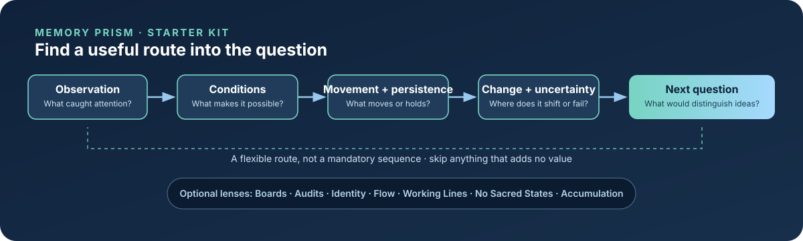

<div align="center">

# MEMORY PRISM

### A structural framework for understanding persistence under constraint

**What can persist, what changes, what gets filtered out—and why?**

[Framework PDF](MemoryPrism-Framework.pdf) · [DOI](https://doi.org/10.5281/zenodo.19287268) · [About](ABOUT.md) · [Starter Kit](starter-kit/Memory-Prism-Starter-Kit-Checklist-v1.1.md) · [Docs](docs/Home.md) · [AI skill](skill/README.md) · [Tests](tests/README.md)

</div>

---



Memory Prism is a way to enter an unfamiliar problem by examining the conditions under which things form, move, persist and fail. It opens an investigation. It does not replace domain knowledge, prescribe every step, or turn curiosity into a checklist exercise.

The published **Framework** is the primary source. Everything else here is a companion tool for applying it.

## Start here

| I want to… | Go to |
|---|---|
| Understand the core concepts | [Framework PDF](MemoryPrism-Framework.pdf) (searchable text: [Markdown](skill/memory-prism/references/source-corpus/Memory-Prism-Framework.md)) |
| Get traction on an unfamiliar topic | [Starter Kit checklist v1.1](starter-kit/Memory-Prism-Starter-Kit-Checklist-v1.1.md) |
| See the seven optional lenses | [The seven lenses](docs/seven-lenses.md) |
| Use it without over-applying it | [How to use Memory Prism](docs/using-memory-prism.md) |
| Use it with an AI assistant | [Skill package](skill/README.md) |
| Run or score the tests | [Tests](tests/README.md) · [Daily protocol](tests/daily/README.md) · [Scoring](tests/daily/SCORING.md) |
| Check what was verified against the sources | [Checklist verification](docs/checklist-verification.md) |

## The entry point

Six questions, used selectively. They are prompts, not mandatory steps.

1. What am I actually trying to understand?
2. What is the board?
3. What moves, accumulates, and costs something? *(flow and accumulation; the ledger)*
4. What makes the arrangement persist? *(pile check; drift and maintenance; identity)*
5. Where does it change, get interpreted, corrected or fail?
6. What is the best next question?

Skip questions that add nothing. The checklist has done its job when it helps find a productive next move.

## Sources

The Starter Kit is derived from the Framework and exactly seven supporting essays:

- **Foundation:** Boards · Audits · Identity · Flow Under Constraint
- **Supplementary:** Working Lines · No Sacred States · Accumulation Patterns

They are optional lenses, not seven boxes every topic must fill. Ledger, Translator, viability and the other concepts in the Framework itself are core, not lenses. Full texts, canonical URLs, provenance and licence: [source corpus](skill/memory-prism/references/source-corpus/README.md) · [SOURCES.md](SOURCES.md).

## Repository map

```text
MemoryPrism-Framework.pdf   The published Framework (primary source)
starter-kit/                The canonical checklist (single source of truth)
skill/memory-prism/         Installable AI skill: SKILL.md + references + source corpus
tests/                      smoke/ (skill behaviour) · daily/ (protocol + scoring) · records/
docs/                       Human-readable reference and verification notes
wiki-seed/                  Pages prepared for the separate GitHub Wiki
case-studies/               Worked applications (not part of the source boundary)
assets/                     README visuals
tools/check_repo.py         Consistency checks (checklist sync, links, test index)
```

## Editorial commitments

- **Framework first; examples are not definitions.**
- **Domain mechanisms outrank analogies.** A structural resemblance is a lead, not proof of a shared mechanism.
- **Evidence and inference stay distinct.**
- **The assistant does the next obvious piece of work** instead of handing the investigation back.
- **No forced coverage.** A lens must earn its place.
- **Answer settled questions directly.** Use MP on the uncertain part.
- **Stop before furnishing every room.**

## Citation and licence

Concept DOI [10.5281/zenodo.19287268](https://doi.org/10.5281/zenodo.19287268) (all versions); version 1.0 DOI [10.5281/zenodo.19287269](https://doi.org/10.5281/zenodo.19287269) (March 2026 release). See [`CITATION.cff`](CITATION.cff) and [`CITATION.md`](CITATION.md).

The official site states **CC BY-NC 4.0** for Memory Prism v1.0; [`LICENSE.md`](LICENSE.md) documents its scope for original content here. Non-commercial sharing and adaptation are permitted under the licence; commercial use needs separate permission. Third-party material keeps its own rights. This is a content licence, not an OSI open-source software licence.

See [`CHANGELOG.md`](CHANGELOG.md) for the latest restructuring and old-to-new path map.
