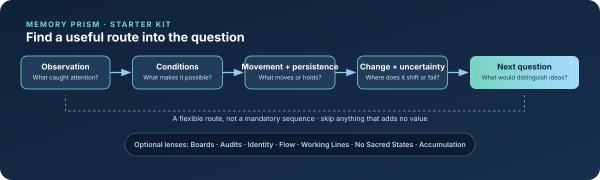

<div align="center">

# MEMORY PRISM

### A structural framework for understanding persistence under constraint

**What can persist, what changes, what gets filtered out—and why?**

[Framework PDF](MemoryPrism-Framework.pdf) · [Start with the checklist](starter-kit/Memory-Prism-Starter-Kit-Checklist-v1.0.md) · [Explore the documentation](docs/Home.md) · [Portable AI skill](skill/README.md) · [Wiki page sources](wiki-seed/Home.md)

</div>

---



Memory Prism is a way to enter an unfamiliar problem by examining the conditions under which things form, move, persist, and fail. It is meant to open an investigation—not to replace domain knowledge, prescribe every step, or turn curiosity into a checklist exercise.

This repository began as a versioned home for the framework PDF. It is being expanded carefully into a readable public reference and a platform-neutral AI skill package, while keeping the framework itself distinct from tools for applying it.

## Start here

| I want to… | Start with |
|---|---|
| Understand the framework's core concepts | [Framework PDF](MemoryPrism-Framework.pdf) |
| Get traction on an unfamiliar topic | [Starter Kit checklist](starter-kit/Memory-Prism-Starter-Kit-Checklist-v1.0.md) |
| Understand the seven supporting lenses | [The seven lenses](docs/seven-lenses.md) |
| See how to use MP without over-applying it | [How to use Memory Prism](docs/using-memory-prism.md) |
| Use the approach with an AI assistant | [Portable skill package](skill/README.md) |
| Browse the documentation | [Documentation home](docs/Home.md) |

## The entry point

The starter kit asks a small set of questions, used selectively:

1. What am I actually trying to understand?
2. What is the board?
3. What moves, accumulates, and costs something?
4. What makes the arrangement persist?
5. Where does it change, get corrected, or fail?
6. What is the best next question?

These are prompts, not mandatory steps. Skip questions that add no value. The checklist has done its job when it helps identify a productive next move.

## The seven supporting essays

The starter kit is derived from the Memory Prism Framework and exactly these seven supporting essays:

- **Boards**
- **Audits**
- **Identity**
- **Flow Under Constraint**
- **Working Lines**
- **No Sacred States**
- **Accumulation Patterns**

They are optional lenses during application, not seven boxes every topic must fill. See [the seven lenses](docs/seven-lenses.md).

## Repository map

```text
MemoryPrism-Framework.pdf   Foundational framework document
docs/                       Human-readable reference documentation
starter-kit/                Canonical checklist source
skill/                      Platform-neutral AI skill package
wiki-seed/                  Markdown pages prepared for GitHub Wiki
assets/                     README visual assets
CONTRIBUTING.md             Editorial and contribution guidance
```

## Editorial commitments

- **Framework first; examples are not definitions.**
- **Domain mechanisms outrank analogies.** A structural resemblance is a lead, not proof of a shared mechanism.
- **Evidence and inference stay distinct.**
- **The assistant does the next obvious piece of work.** It should research, compare, inspect, or test instead of repeatedly handing the investigation back to the user.
- **No forced coverage.** A lens must earn its place.
- **Answer settled questions directly.** Use MP to open the uncertain part, not to delay an answer.
- **Stop before furnishing every room.** This is a starter kit, not a total analysis protocol.

## Status

The framework PDF remains the primary framework artifact. The checklist and AI skill are companion tools for entering and investigating topics. Documentation is organised in `docs/`; import-ready GitHub Wiki page sources live in `wiki-seed/`. The Wiki feature is enabled on this repository, but GitHub's separate Wiki store must be initialised/published separately from regular repository files.

## License and reuse

No repository-wide software or content license is declared here. Check the individual source record or contact the maintainer before reusing material beyond applicable copyright exceptions.
